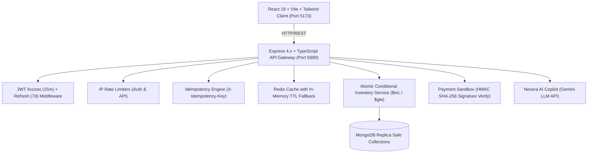

# 🚀 NEXORA – Scalable E-Commerce Platform

> **Gen-Z Futuristic High-Concurrency Commerce SaaS**  
> Engineered to Amazon SDE Portfolio Standards with Node.js, Express, TypeScript, MongoDB, Redis In-Memory Caching, React 18, TailwindCSS, Zod, and Vitest.

---

## 🎨 1. Design System & Brand Identity

Designed with a sleek, Gen-Z, futuristic, and premium SaaS aesthetic:

| Token | Hex Code | Visual Application |
|---|---|---|
| **Dark Navy** | `#10101B` | Global background canvas across customer & admin |
| **Electric Purple** | `#8B5CF6` | Primary action buttons, brand accents, glow shaders |
| **Neon Lime** | `#D9FF57` | Telemetry metrics, badges, live status indicators |
| **Dark Slate** | `#242235` | Rounded component cards (18px) with subtle borders |
| **White** | `#FFFFFF` | Primary headers and high-contrast typography |
| **Lavender Grey** | `#B9B8C9` | Secondary descriptors and subtle technical metadata |
| **Mint Green** | `#34D399` | In-stock confirmations, successful transactions |
| **Coral Red** | `#FB7185` | Low stock alerts, depleted inventory, transaction failures |

---

## 🏛️ 2. Architectural Highlights



### ⚡ Critical Engineering Safeguards

1. **Zero Overselling Under Concurrency**:  
   Inventory deductions are handled via conditional atomic atomic operations:
   ```typescript
   Product.findOneAndUpdate(
     { _id: productId, stock: { $gte: quantity } },
     { $inc: { stock: -quantity } },
     { new: false }
   );
   ```
   If any item in a cart fails due to concurrent race conditions, all previously reserved items in that batch are instantly rolled back, guaranteeing stock never drops below zero.

2. **Redis Invalidation with Graceful In-Memory Fallback**:  
   Product queries are cached for 300s. Whenever a product is modified, created, or purchased, wildcard keys matching `products:*` are invalidated. If Redis is offline, the backend seamlessly switches to a high-speed In-Memory TTL cache without server degradation or downtime.

3. **Idempotency Safeguard**:  
   Orders and payment endpoints accept `X-Idempotency-Key`. Duplicate network requests within 1 hour return cached transaction records instead of double-charging or double-deducting stock.

4. **Strict Order State Machine**:  
   Allowed state transitions are strictly governed:
   `Pending` → `Confirmed` → `Processing` → `Shipped` → `Delivered`  
   Illegal skips (such as `Confirmed` directly to `Delivered`) return HTTP 400. Cancellations automatically replenish reserved stock into live catalog inventory.

5. **Server-Side Cryptographic Signature Verification**:  
   Razorpay / Stripe sandbox payment responses are authenticated via HMAC SHA-256 hashes generated server-side.

---

## 💻 3. Technology Stack

- **Frontend**: React 18, Vite, TypeScript, Tailwind CSS, TanStack Query, React Router v6, Axios, Recharts, Lucide React
- **Backend**: Node.js, Express.js, TypeScript, REST APIs (`/api/v1`), Zod validation schemas, bcrypt password hashing, JWT rotation
- **Database**: MongoDB 7.0, Mongoose, compound indexing, text search indexes
- **Caching**: Redis / In-Memory TTL Cache fallback
- **Payments**: Razorpay & Stripe Sandbox test integration
- **AI & Developer APIs**: Google Gemini LLM API (Catalog Copilot) & GitHub REST API
- **Testing**: Vitest & Supertest automated integration test suite

---

## 🗄️ 4. Database Schema Structure

The platform implements 10 related MongoDB collections:

- `User`: Email (unique index), passwordHash (select: false), role (`customer` | `admin`), addresses subdocuments.
- `Product`: Title (text index), slug (unique index), price, costPrice, stock, lowStockThreshold, category (ref Category), images, rating, SKU (unique index).
- `Category`: Name, slug, description, image, icon, isActive, productCount.
- `Cart`: User reference, items subdocuments with quantity and price, appliedCoupon.
- `Order`: OrderNumber (`NEX-YYYY-XXXXX`), status, items, shippingAddress, paymentStatus, subtotal, shippingFee, tax, discount, idempotencyKey, statusHistory.
- `Payment`: Order reference, user reference, transactionId (unique), amount, gateway, signature, status.
- `InventoryLog`: Product reference, changeType (`purchase`, `cancellation_restock`, `admin_adjustment`), quantityChange, previousStock, newStock, reason.
- `Coupon`: Code (uppercase unique index), discountType (`percentage` | `fixed`), discountValue, minOrderValue, maxDiscount, usageLimit.
- `Review`: User and Product compound unique index, rating (1-5), comment.
- `RefreshToken`: User reference, token, expiresAt (TTL index for automatic purge).

---

## 🚀 5. Quick Start Instructions

### Prerequisites
- Node.js >= 20.x
- MongoDB (Running locally on default port `27017` or via Docker)

### Option A: Local Development

1. **Clone & Setup Root**:
   ```bash
   cd "e:\Scalable E-Commerce Backend"
   npm install
   ```

2. **Seed Initial Database**:
   ```bash
   npm run seed
   ```

3. **Launch Full-Stack Dev Servers**:
   ```bash
   npm run dev
   ```
   - **Frontend**: http://localhost:5173
   - **Backend API**: http://localhost:5000/api/v1
   - **Health Telemetry**: http://localhost:5000/health

---

### Option B: Docker Containerization

```bash
docker compose up --build
```
Runs MongoDB, Redis, Node.js Backend API, and Nginx Frontend concurrently.

---

## 🧪 6. Automated Test Suite

NEXORA includes 18 automated integration tests using Vitest and Supertest:

```bash
npm run test
```

### Verified Test Cases:
1. User registration with email hashing & JWT token issuance
2. Duplicate email rejection (HTTP 409)
3. Invalid credentials rejection (HTTP 401)
4. Admin login & role authorization
5. Customer access denial on protected Admin analytics (HTTP 403)
6. Admin access granted on operations telemetry (HTTP 200)
7. Product catalog pagination and category filtering
8. Keyword text search
9. Admin product creation with automatic cache invalidation
10. Cart calculations and quantity management
11. Coupon validation (e.g., `TEST50` percentage discount calculation and caps)
12. Invalid or expired coupon rejections
13. Order creation from cart and atomic stock decrement
14. Concurrency safety: Oversell prevention when quantity exceeds stock
15. Idempotent safe checkout: Duplicate prevention via `X-Idempotency-Key`
16. Cryptographic sandbox payment HMAC SHA-256 verification
17. Valid order lifecycle transitions (`Confirmed` → `Processing` → `Shipped`)
18. Illegal order state transition rejection (`Confirmed` directly to `Delivered`)

---

## 🔑 7. Seed Accounts & Test Coupons

### Administrator Account
- **Email**: `admin@nexora.com`
- **Password**: `Admin@12345`
- **Access**: Complete control over Products, Orders, Inventory Alarms, Ledger, and Analytics.

### Demo Customer Account
- **Email**: `customer@nexora.com`
- **Password**: `Customer@12345`
- **Saved Address**: 12 Neo Boulevard, Cybercity Phase 2, Hyderabad, Telangana

### Promotional Discount Codes
- `NEXORA20`: 20% off up to ₹2,000 on orders above ₹1,000
- `FUTURE10`: 10% instant discount on orders above ₹500
- `TECHVIP`: Flat ₹500 off on tech hardware orders above ₹2,500
